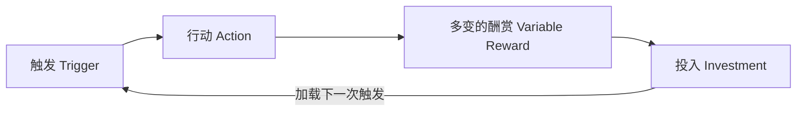
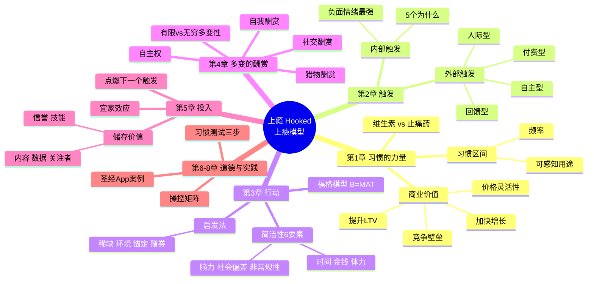

# 《上瘾》(Hooked) 重点章节总结 + 思维导图

> 作者：尼尔·埃亚尔 (Nir Eyal)，副标题：让用户养成使用习惯的四大产品逻辑
> How to Build Habit-Forming Products

📌 **交互式思维导图**：打开本目录下的 [`mindmap.html`](./mindmap.html)（浏览器直接打开即可，无需联网）。

---

## 全书一句话

让用户"上瘾"的产品，靠的不是运气，而是一个可以刻意设计的循环——**上瘾模型 (Hook Model)**：
**触发 → 行动 → 多变的酬赏 → 投入**，每转一圈，用户与产品的绑定就更深一层，直到产品成为用户的"默认习惯"。

---

## 第 1 章：习惯的力量 (The Habit Zone)

**核心观点**：习惯是"无意识出现的行为"。当用户不假思索地打开你的产品，你就拥有了最深的护城河。

- **习惯给企业带来的价值**
  - 提升用户终身价值 (LTV)：用得越久，贡献越大
  - 提高价格灵活性：习惯养成后，用户对涨价不敏感（如游戏先免费后收费）
  - 加快增长速度：高频用户是自传播的核心（口碑、邀请）
  - 增强竞争壁垒：用户习惯是后来者最难撼动的资产（QWERTY 键盘效应）
- **习惯区间 (Habit Zone)**：两个坐标决定产品能否成为习惯
  - **发生频率**：行为多久发生一次
  - **可感知用途**：相比替代方案，好处有多明显
  - 频率高 + 用途明确 → 进入习惯区间
- **维生素 vs 止痛药**：成功的习惯类产品起初像"维生素"（可有可无），一旦习惯养成就变成"止痛药"（不用就难受）

---

## 第 2 章：触发 (Trigger)

**核心观点**：触发是行为的"火花塞"。先用外部触发拉新，最终要让产品和用户的**内部情绪**绑定。

- **外部触发**（把下一步行动嵌在信息里）
  1. **付费型**：广告、SEM——拉新可以，留存太贵
  2. **回馈型**：媒体报道、热门推荐——爆发式但不可持续
  3. **人际型**：朋友推荐、分享、邀请——最有效的"病毒式"触发
  4. **自主型**：通知、图标红点、邮件订阅——用户授权后驱动重复回访的主力
- **内部触发**（产品与情绪、场景、日常行为挂钩）
  - **负面情绪是最强大的内部触发**：无聊→刷抖音；孤独→刷朋友圈；不确定→搜一下；怕错过 (FOMO)→刷动态
  - 设计方法：反复问"用户为什么这么做"（5 个为什么），找到情绪层面的根源痛点
- **目标**：从依赖外部触发 → 过渡到内部触发自动唤起，产品成为情绪的"第一反应"

---

## 第 3 章：行动 (Action)

**核心观点**：期待酬赏时的直接反应。要让行为发生，做起来必须比想一想还容易。

- **福格行为模型：B = MAT**——行为发生需同时具备
  - **M (Motivation) 动机**：追求快乐 / 逃避痛苦；追求希望 / 逃避恐惧；追求认同 / 逃避排斥
  - **A (Ability) 能力**：完成行为的难易程度
  - **T (Trigger) 触发**：提醒行动的信号
- **简洁性 6 要素**（任何一项越费劲，行为越难发生）
  1. 时间 2. 金钱 3. 体力 4. 脑力 5. 社会偏差（他人接受度） 6. 非常规性（与日常的匹配度）
  - **先解决能力问题，再谈动机**：简化路径比说服用户更有效
  - 案例：Twitter 140 字降低创作门槛、Google 一个搜索框、iPhone 相机锁屏直达
- **启发法：可利用的心理捷径**
  - 稀缺效应（仅剩 2 件）、环境效应（场景改变判断）、锚定效应（原价划掉）、赠券效应（进度条已帮你走了 2 步）

---

## 第 4 章：多变的酬赏 (Variable Reward)

**核心观点**：满足用户的不是酬赏本身，而是**对酬赏的渴望**。"多变性"让大脑的多巴胺系统持续兴奋——这是老虎机的原理，也是无限下拉刷新的原理。

- **三种多变酬赏**（强产品往往三者兼备）
  1. **社交酬赏（部落酬赏）**：来自他人的认同、点赞、评论、连接感——朋友圈、微博、Stack Overflow
  2. **猎物酬赏**：对资源和信息的追逐——信息流的下一条、拼多多的优惠、老虎机的奖金
  3. **自我酬赏**：操控感、成就感、终结感——游戏升级、清空收件箱 (Inbox Zero)、技能进阶
- **两个关键提醒**
  - **保留自主权**："你可以自由选择"比强迫更能改变行为；逼用户就范会引发逆反（Reactance）
  - **有限的多变性 vs 无穷的多变性**：剧情看完就腻（有限），用户生成内容/社交动态常刷常新（无穷）——后者才能长期维持兴趣
- 酬赏必须**挠到内部触发那个"痒处"**，否则再多变也没用

---

## 第 5 章：投入 (Investment)

**核心观点**：让用户在产品里"存点什么"。投入越多，离不开的理由越多——这是上瘾模型区别于普通反馈回路的关键一步。

- **心理机制**
  - **宜家效应**：自己动手组装的家具更珍惜——用户会高估自己劳动成果的价值
  - **认知失调 & 一致性偏好**：我们会为过去的投入辩护，并按过去的行为塑造未来的行为
- **储存价值的 5 种形式**（用得越多、价值越大，与"用完即损耗"的实体产品相反）
  1. **内容**：收藏的歌单、相册、笔记
  2. **数据资料**：文件、履历（LinkedIn 填得越全越离不开）
  3. **关注者**：粉丝、人脉关系链（迁移成本极高）
  4. **信誉**：评分、等级、信用记录（淘宝卖家、滴滴司机）
  5. **技能**：越熟练越不想换（PS、快捷键、投入的学习成本）
- **点燃下一个触发**：投入的动作本身会带来下一次回访的理由——发了消息等回复、关注了人等更新——让用户"自己给自己上钩"

---

## 第 6 章：上瘾模型与道德操控 (The Morality of Manipulation)

**核心观点**：习惯设计是一种"超能力"，用它之前先过道德关。

- **操控矩阵**：两个问题定位你的角色
  - ① 我自己会使用这个产品吗？ ② 它能帮用户大幅提高生活质量吗？
  | | 开发者自己用 | 开发者自己不用 |
  |---|---|---|
  | **能改善用户生活** | ✅ 健康习惯推广者（问心无愧） | ⚠️ 兜售者（容易自欺，成功率低） |
  | **不能改善生活** | 🎰 娱乐用户者（艺术易过时） | ❌ 经销商（剥削用户，如赌博） |
- 做"健康习惯推广者"：做你自己会用、且真心相信能让用户生活更好的产品

---

## 第 7-8 章：案例研究与习惯测试 (Case Study & Habit Testing)

- **第 7 章 案例：《圣经》App (YouVersion)**
  - 完整跑通上瘾模型：推送/阅读计划（触发）→ 一小段经文、音频版降低门槛（行动）→ 每日不同内容、社群共读（多变酬赏）→ 书签、笔记、打卡记录（投入）
- **第 8 章 习惯测试 (Habit Testing)**：三步循环
  1. **确定用户**：谁是习惯用户？定义标准（多久用一次算习惯）
  2. **分析用户行为**：找出习惯用户的共同行为路径（"习惯路径"，如 Twitter 的"关注 30 人"）
  3. **改进产品**：引导新用户走上同样路径，再测再改
- **发现习惯养成的机会**
  - 观察自己的习惯与痛点（抓痒式创新）
  - 关注新兴行为、新技术、新接口（界面变革处藏着机会）

---

## 快速记忆卡

| 阶段 | 一句话 | 关键工具 |
|---|---|---|
| 触发 | 提示用户行动 | 外部触发 4 种 → 绑定内部情绪 |
| 行动 | 让行为简单到不用想 | B=MAT、简洁性 6 要素 |
| 多变的酬赏 | 制造"猜不到"的期待 | 社交 / 猎物 / 自我 |
| 投入 | 让用户存下带不走的价值 | 内容·数据·关注者·信誉·技能 |

